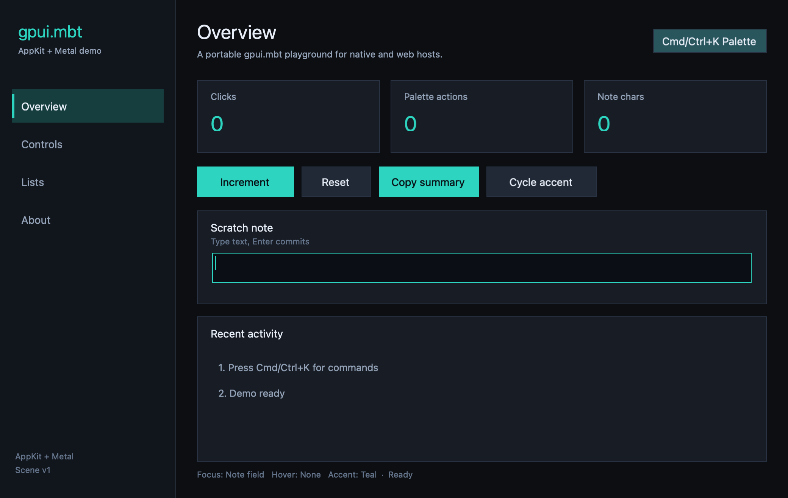
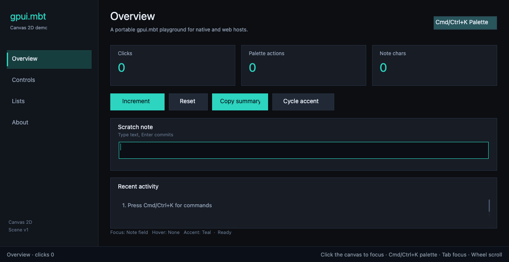

# gpui-mbt-app-demo

Proof-of-concept applications built with [gpui.mbt](https://github.com/gpui-mbt/gpui.mbt).
The same portable model and scene compose into a macOS AppKit + Metal window and
a browser Canvas 2D application, and a Windows Win32 + D3D11 entry. Linux is next.





Live web demo: **https://gpui-mbt.github.io/gpui-mbt-app-demo/**


## Status

| Platform | Status | Entry | Host |
| --- | --- | --- | --- |
| macOS | Working | `src/app` | AppKit + Metal + CoreText |
| Web | Working preview | `src/web` | Canvas 2D + DOM input |
| Linux | Planned | TBD | Wayland/X11 + GLES |
| Windows | Working preview | `windows-app/src/windows` | Win32 + D3D11 + DirectWrite |

This is a demo repository, not a production support claim. See
[Platform status](docs/platforms.md) for details.

## What it demonstrates

- `app.WindowView` / `app.run_window` on macOS: sampled window metrics, event
  sequence and scene viewport/scale checks, close policy and bounded ticks.
- `scene.SceneBuilder`: stable item IDs, clip-chain deduplication, border
  quads and measured text placement.
- Shared `Button`, `TextField` and `CommandPalette` models across native and web.
- `platform/macos_app`: CoreText label painter, TextField measure/admit/hit
  callbacks, cursor state and one-window startup.
- `TextFieldPaintPalette`: themed inline field painting.
- A browser controller with a string/JSON ABI and a Canvas 2D scene renderer,
  built without a bundler.
- Synthetic frame evidence: native pixel checks and headless-Chrome screenshots.

## Requirements

- MoonBit toolchain (the repository is developed against `0.1.20261012`)
- macOS 13+ and Xcode command-line tools for the native app
- Node.js 22+ and Chrome/Chromium for the web smoke test
- A `gpui.mbt` checkout for macOS native shim sources (not needed for web)

## Dependency policy

`moon.mod` pins the published `f4ah6o/gpui@0.9.0` package. A normal web build
uses that package directly.

For framework development, opt in to a gitignored workspace override:

```sh
./scripts/use-local-gpui.sh          # sibling ../gpui.mbt
./scripts/use-local-gpui.sh PATH     # explicit checkout
```

The override writes `moon.work`, which is ignored by git. Remove it to test the
published package again. CI runs a published-package lane on every push and a
`gpui.mbt` main lane on manual dispatch. The
[release and publication checklist](docs/release.md) tracks future pins.

## macOS

```sh
./build.sh            # build and launch in the background
./build.sh --build    # build and print the .app path
./build.sh --verify   # launch, verify it stays alive, then stop it
./build.sh --smoke    # synthetic input + pixel checks + PNG artifacts
```

The bundle is `build/GpuiMacDemo.app`; logs and PID data are next to it. The
MoonBit packages resolve from the published `0.9.0` dependency; native builds
additionally need the gpui.mbt Objective-C shim sources. Pass `--gpui-root` or
set `GPUI_ROOT` when the checkout is not at `../gpui.mbt`:

```sh
GPUI_ROOT=/path/to/gpui.mbt ./build.sh --build
```

## Windows

Windows builds use Win32 + D3D11 + DirectWrite through `windows-app` and the
shared `src/native` controller. The Windows module consumes the published
`platform/windows_app` package:

```powershell
pwsh -NoProfile -File scripts/build_windows.ps1 -Mode build
pwsh -NoProfile -File scripts/build_windows.ps1 -Mode smoke
```

Pass `-GpuiRoot` only when testing a local gpui.mbt checkout.

The smoke writes PPM frames to `build/windows-smoke/`. It uses the backend's
synthetic event queue (`GPUI_NATIVE_E2E=1`) and frame readback
(`GPUI_WINDOWS_READBACK=1`); it is not physical-input or IME evidence. See
[Windows demo](docs/windows.md) for details and limits.

## Web

```sh
./scripts/build_web.sh
python3 -m http.server 8765 --directory web
# open http://127.0.0.1:8765/
```

The build compiles `src/web` to `web/moonbit.js`. The page is a static ES-module
app: `web/host.js` forwards pointer, keyboard and wheel input, and
`web/canvas-renderer.js` draws the v1 quad/text-run snapshot.

Smoke test with headless Chrome:

```sh
./scripts/build_web.sh
node scripts/smoke_web.mjs
# screenshots: build/web-smoke/
```

Set `CHROME_BIN` if Chrome is not at the default macOS path or on `PATH`. The
smoke checks navigation, increment, note entry, command-palette search and
accent activation, list selection, and writes five screenshots.

## UI and shortcuts

Pages: **Overview**, **Controls**, **Lists**, **About**.

- Click sidebar items or use **Cmd/Ctrl+1** … **Cmd/Ctrl+4** (native also
  supports Cmd+1..4).
- **Cmd/Ctrl+K** opens the command palette; type to filter, Up/Down select,
  Enter run, Escape close, or click outside the panel.
- **Tab** / **Shift+Tab** move focus. Enter/Space activate a focused button.
- Increment, reset, copy summary (native), toggle loading, cycle the accent and
  open the palette are available as buttons and commands.
- The note field accepts printable text, selection, Backspace, Delete, arrows,
  Home/End, undo/redo and Enter submit. Native adds clipboard and a text cursor.
- Lists scroll with the wheel, arrows, PageUp/PageDown, Home/End and pointer
  selection.
- Native: **Cmd+Q** exits and **Cmd+W** requests close.

## Tests

```sh
moon test --target native --deny-warn src/model src/scene
moon test --target js --deny-warn src/model src/scene
moon fmt --check src/model src/scene src/app src/web
./build.sh --smoke
node scripts/smoke_web.mjs
```

`src/model` tests page/intent transitions, activity bounds, selection, scroll,
responsive layout, unique widget IDs and palette geometry. `src/scene` tests
that the shared scene composes without a native text backend. Native and web
integration are covered by the two smoke flows.

## Layout

```text
src/model/     portable state, intents, theme and responsive layout
src/scene/     portable SceneBuilder composition
src/native/    shared session, input, scene adapter and smoke driver
src/app/       thin macOS AppKit/Metal host and platform ops
windows-app/   separate Windows module (Win32/D3D11/DirectWrite entry)
src/web/       browser controller and string/JSON ABI
web/           static HTML/CSS/JS host and Canvas 2D renderer
scripts/       local dependency override, app/web build and smoke helpers
docs/          architecture, platform status and conformance relationship
```

## Conformance

The comparison and evidence suite lives in
[gpui-conformance](https://github.com/gpui-mbt/gpui-conformance). This repository
is its downstream demo/consumer; see
[Relationship to gpui-conformance](docs/conformance.md).

## Limits

- No Japanese IME, committed text-input transport, native menu bar or general
  accessibility tree. The native app uses an application-level printable-key
  adapter and one bounded Button accessibility binding.
- Web text measurement and caret geometry are deterministic approximations, not
  browser font shaping. Web has no clipboard bridge or IME.
- The scene subset is quads, bounded text runs, affine transforms, opacity and
  rectangle clips. Rounded corners, gradients, images and paths are unused.
- Windows uses a synthetic input queue for smoke; physical keyboard/IME and
  UI Automation are not implemented. The demo uses one HWND.
- Linux Wayland/X11 entries are not implemented yet.
- macOS native builds still require a `gpui.mbt` checkout for the Objective-C
  shim sources; the MoonBit APIs themselves come from published `0.9.0`.
