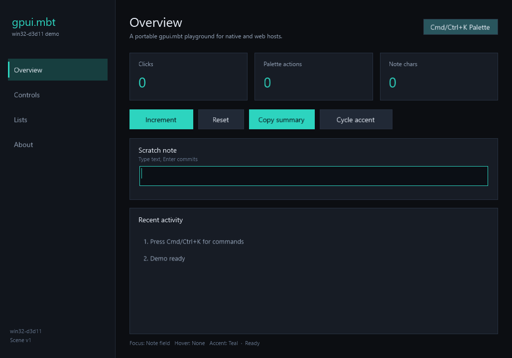

# Windows demo



`windows-app` is a separate MoonBit module with an executable entry over the
shared `src/native` session.

## Host stack

- `f4ah6o/gpui/windows` — Win32 window, D3D11 renderer, clipboard, cursor,
  frame readback and synthetic-input hooks.
- `f4ah6o/gpui/platform/windows_text` — DirectWrite measurement, admission and
  hit testing.
- `f4ah6o/gpui/platform/windows_app` — reusable `WindowsTextPainter`,
  `WindowsTextFieldAdapter`, `CursorState` and `run_main_window` (currently on
  gpui.mbt main, not yet in the published 0.8.0 package).
- `src/native` — shared `DemoSession`, input handling, scene composition and
  smoke driver.

## Build

From a Developer PowerShell for VS 2022:

```powershell
./scripts/use-local-gpui.sh ..\\gpui.mbt
pwsh -NoProfile -File scripts/build_windows.ps1 -Mode build -GpuiRoot ..\\gpui.mbt
pwsh -NoProfile -File scripts/build_windows.ps1 -Mode run   -GpuiRoot ..\\gpui.mbt
pwsh -NoProfile -File scripts/build_windows.ps1 -Mode smoke -GpuiRoot ..\\gpui.mbt
```

The script creates a gitignored `windows-app/moon.work` pointing at the gpui.mbt
checkout, checks that `cl.exe` is available, builds `windows-app/src/windows`,
and writes smoke artifacts under `build/windows-smoke/`.

## Smoke and limits

The smoke sets `GPUI_NATIVE_E2E=1` and `GPUI_WINDOWS_READBACK=1`, then drives
the same scenario as macOS/Web through the event queue:

- initial overview frame
- increment button
- note text entry
- command palette search and accent command
- lists selection
- page shortcuts

This is event-queue and frame-readback evidence, not proof of physical input,
IME, UI Automation, multi-window behavior or DPI-transition correctness. The
demo uses a single HWND. The Windows lane tracks gpui.mbt main until the next
release contains `platform/windows_app`; see [release](release.md).
